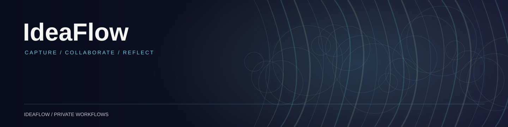

# IdeaFlow

> **Public documentation note · November 3, 2026:** The default branch remains a recovery/documentation landing page. Older automated analysis workflows are not the current manual, on-demand direction. Reconcile source and privacy controls before describing a full application or release.

[Recovery work](https://github.com/devonalanakins/ideaflow/pull/1) · [Development branches](https://github.com/devonalanakins/ideaflow/pulls)

IdeaFlow is an idea-capture and occasional meeting-workflow project. It is being separated into its own public-safe source repository, independent of the private recordings and transcripts it may process.

## Source status

**Reconciliation pending.** An earlier intake/analyzer/operations code archive and a separate meeting-presenter release have been identified. The older intake implementation predates the latest workflow decision and must not be presumed to match production. No verified standalone source has been imported here yet.

[Draft recovery PR #1](https://github.com/devonalanakins/ideaflow/pull/1) preserves a compiled analyzer reference and synthetic tests. It is not the complete editable application or a deployment candidate; the other services and recovery checks remain outstanding.

## Operating requirements

- Capture is on demand. Meeting transcription retrieval and idea analysis require an explicit manual request; do not restore automatic daily analysis or summary tasks.
- Necessary retention, deletion, privacy, and authorization safeguards must continue independently of manual processing.
- Do not publish recordings, transcripts, private idea content, tokens, provider secrets, private configuration, or historical database exports.
- Identify the authoritative running version and recover the corresponding source before moving deployment ownership.
- Preserve provenance, licenses, tests, and rollback instructions; do not rebuild an existing app to fill the repository.

The current deployed service and private data remain outside this repository until verified transfer.

Portfolio context: [Devon Alan Akins](https://github.com/devonalanakins/anevum) · [October 2026 historical source handoff](https://github.com/devonalanakins/anevum/blob/main/handoffs/ANEVUM.OPS.PACKAGE.2026-10-30.002.md). IdeaFlow remains independent of the Anevum creative studio.
